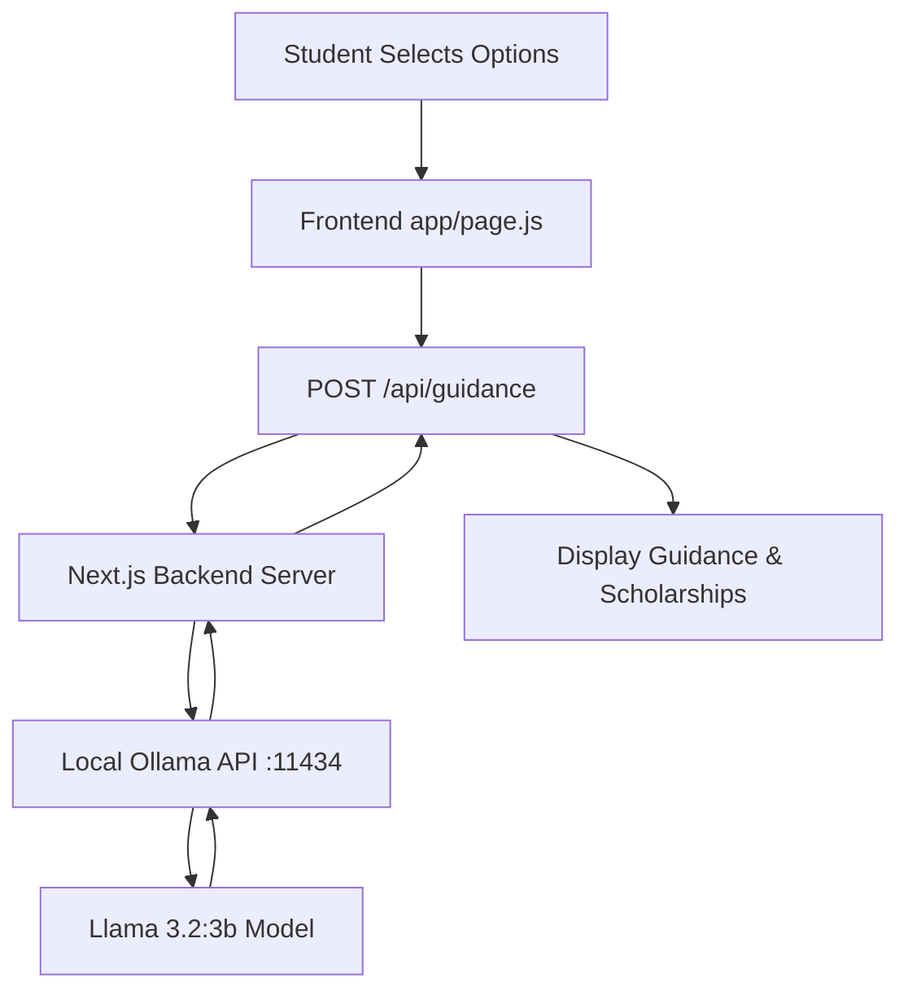

# 🎓 CareerPath India - AI-Powered Career Guidance

**CareerPath India** is a modern, interactive web application designed to help Indian students navigate their educational and professional futures. By answering a series of targeted questions about their current education level and interests, students receive personalized guidance on courses, entrance exams, top colleges, and available scholarships—all powered by **Local AI**.

---

## 🚀 Key Features

- **Interactive Journey**: A step-by-step selection process tailored for 10th pass, 12th pass, and Graduates in India.
- **AI-Powered Guidance**: Generates realistic, up-to-date information on courses, duration, eligibility, and fees.
- **Scholarship Discovery**: Automatically identifies relevant government and private scholarships (like PMS, INSPIRE, etc.).
- **Privacy First**: Uses local LLMs (Llama 3.2) via Ollama, ensuring student data never leaves their machine.
- **Premium UI**: Dark-themed, responsive design with smooth animations and a "Journey Sidebar" to track your choices.

---

## 🛠️ Technology Stack

- **Frontend**: [Next.js](https://nextjs.org/) (App Router), React 19, Vanilla CSS.
- **Backend AI Integration**: Local API routes calling an **Ollama** server.
- **AI Model**: `llama3.2:3b` (Llama 3.2 3 Billion parameters).
- **Styling**: Modern dark-mode aesthetic with custom animations and variable-based design tokens.

---

## 🔄 How It Works (The Flow)



1.  **Frontend Journey**: As a user selects options, their "journey" is tracked in the React state.
2.  **API Call**: Upon reaching a final field of interest, the frontend sends the entire journey to a secure server-side route.
3.  **Local LLM Interaction**: The backend server constructs a prompt for the career guidance expert and communicates with a local **Ollama** instance.
4.  **JSON Structured Data**: The AI is instructed to return data in a specific JSON format, including detailed course info and scholarships.
5.  **Dynamic Rendering**: The frontend parses the AI response and renders Course Cards and Scholarship Chips instantly.

---

## 📦 Setup & Installation

### 1. Prerequisites
- **Node.js** (v18 or later)
- **Ollama** installed on your machine. You can download it from [ollama.com](https://ollama.com).

### 2. Prepare the AI Model
Open your terminal and pull the required model:
```bash
ollama run llama3.2:3b
```
Ensure Ollama is running in the background.

### 3. Clone and Install
```bash
# Install dependencies
npm install
```

### 4. Run the Development Server
```bash
npm run dev
```
Open [http://localhost:3000](http://localhost:3000) with your browser to start your journey.

---

## 🛡️ License
This project is for educational purposes. Feel free to use and modify it for your own career guidance tools.